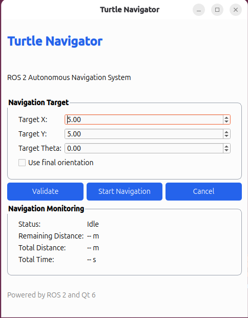
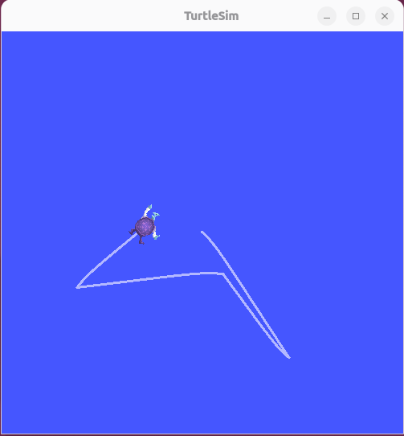
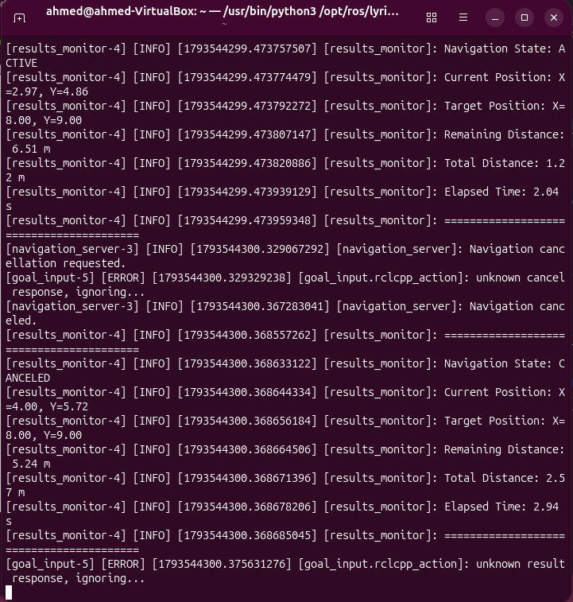

# 🐢 Turtle Navigator

**An Autonomous Navigation System Built with ROS 2, C++, and Qt 6**

Turtle Navigator is a ROS 2-based project that demonstrates autonomous navigation in a 2D simulation environment using Turtlesim. It integrates a Qt 6 graphical user interface with ROS 2 communication mechanisms to provide goal input, validation, action-based navigation, and real-time monitoring.

---

## 📌 Project Overview

The system allows users to specify a target position and optionally a final orientation through a graphical interface.

Before navigation begins, the requested goal is checked by a dedicated validation service. Once accepted, the navigation server controls the turtle, provides continuous feedback, and reports the final navigation results.

The project demonstrates how multiple ROS 2 nodes and communication mechanisms can work together as an integrated application.

## ✨ Key Features

- **Graphical User Interface:** Qt 6 interface for entering target coordinates and optional orientation.
- **Goal Validation:** Validates requested goals through a custom ROS 2 service.
- **Autonomous Navigation:** Executes navigation using a custom ROS 2 Action Server.
- **Continuous Feedback:** Reports the remaining distance during navigation.
- **Goal Cancellation:** Supports cancellation of active navigation goals.
- **Goal Replacement:** Handles a new goal while another goal is active.
- **Real-Time Monitoring:** Tracks navigation state, position, distance, and elapsed time.
- **Dynamic Parameters:** Allows runtime adjustment of the goal validator's safety margin.

## 🏗️ System Architecture

The project consists of two ROS 2 packages:

| Package | Description |
|---|---|
| `turtle_navigator` | Contains the application nodes, Qt GUI, and launch file. |
| `turtle_navigator_interfaces` | Defines the custom ROS 2 messages, service, and action. |

### Main ROS 2 Nodes

| Node | Responsibility |
|---|---|
| `goal_input` | Provides the Qt 6 graphical interface for submitting navigation goals. |
| `goal_validator` | Validates target coordinates through a ROS 2 service. |
| `navigation_server` | Executes navigation goals and controls turtle motion. |
| `results_monitor` | Monitors and reports navigation status and measurements. |
| `turtlesim_node` | Provides the 2D simulation environment. |

## 🔄 ROS 2 Communication

The application demonstrates several ROS 2 communication mechanisms:

| Mechanism | Purpose |
|---|---|
| Topics | Exchange turtle velocity, pose, and navigation status. |
| Services | Validate navigation goals. |
| Actions | Execute navigation goals with feedback, results, and cancellation. |
| Parameters | Configure the goal validation safety margin at runtime. |

### Custom Interfaces

The `turtle_navigator_interfaces` package defines:

- `Goal.msg`
- `NavigationStatus.msg`
- `ValidateGoal.srv`
- `NavigateToGoal.action`

## 🛠️ Technologies

- ROS 2 Lyrical
- C++
- Qt 6 Widgets
- Ubuntu 26.04 LTS
- CMake
- colcon
- Turtlesim

## ⚙️ Requirements

- Ubuntu 26.04 LTS
- ROS 2 Lyrical
- C++ compiler
- CMake
- colcon build tools
- Qt 6 development libraries
- rosdep

## 🚀 Installation and Build

### 1. Clone the Repository

```bash
git clone https://github.com/AhmedSamy-Mohamed/Turtle-Navigator.git
cd Turtle-Navigator
```

### 2. Source ROS 2

```bash
source /opt/ros/lyrical/setup.bash
```

### 3. Install Dependencies

```bash
rosdep update
rosdep install --from-paths src --ignore-src -r -y
```

### 4. Build the Workspace

```bash
colcon build --packages-up-to turtle_navigator
```

### 5. Source the Workspace

```bash
source install/setup.bash
```

## ▶️ Running the System

Launch the complete application:

```bash
ros2 launch turtle_navigator turtle_navigator.launch.py
```

The launch file starts the Turtlesim simulator and the four application nodes.

## 🎯 Navigation Workflow

1. Enter the target X and Y coordinates through the GUI.
2. Optionally enable final orientation and specify the target angle.
3. Validate the requested goal.
4. Start navigation after successful validation.
5. Monitor navigation progress and measurements.
6. Cancel the active goal when required.

## 🧪 Testing and Validation

The following functional scenarios have been tested:

- Successful navigation to a target position.
- Rejection of invalid or unsafe goals through the validation service.
- Runtime modification of the safety margin parameter.
- Replacement of an active navigation goal.
- Cancellation of an active navigation goal.
- Navigation status and measurement monitoring.

### 🎥 Project Demonstration

A demonstration video showcasing the Turtle Navigator system, including goal input, autonomous turtle movement, and navigation feedback.

[Watch the Turtle Navigator Demo](media/demo/turtle_navigator_demo.mp4)

### 🖥️ Qt GUI



### 🐢 Turtlesim Simulation



### 📊 ROS 2 Monitoring



## 📚 Documentation

Detailed technical documentation is available in the `docs/` directory.

| Document | Description |
|---|---|
| [Architecture](docs/architecture.md) | System architecture and ROS 2 node communication. |
| [System Design](docs/system_design.md) | Internal system behavior and navigation execution. |
| [Nodes Documentation](docs/nodes_documentation.md) | Responsibilities and implementation of each node. |
| [ROS 2 Concepts](docs/ros2_concepts.md) | ROS 2 communication mechanisms and concepts used in the project. |
| [Interfaces](docs/interfaces.md) | Custom messages, services, and actions. |
| [Navigation Algorithm](docs/navigation_algorithm.md) | Navigation calculations and motion control strategy. |
| [Testing and Validation](docs/testing_and_validation.md) | Functional test scenarios and observed results. |
| [Limitations and Future Work](docs/limitations_and_future_work.md) | Current limitations and possible future improvements. |

## ⚠️ Project Scope and Limitations

Turtle Navigator is an educational ROS 2 navigation implementation operating in a simulated 2D environment.

The project uses a custom navigation controller and Turtlesim. It does not currently implement:

- SLAM or map generation.
- Map-based navigation.
- Obstacle detection and avoidance.
- The ROS 2 Nav2 navigation stack.

The main objective is to demonstrate ROS 2 architecture, communication mechanisms, basic motion control, action handling, GUI integration, and navigation monitoring.

## 🔮 Future Improvements

- Improve navigation controller performance.
- Add obstacle detection and avoidance.
- Integrate mapping and localization.
- Explore integration with the ROS 2 Nav2 stack.
- Expand automated testing.

## 👨‍💻 Author

**Ahmed Samy**

Mechatronics, Robotics and Automation Engineering  
Tanta University

[GitHub Profile](https://github.com/AhmedSamy-Mohamed)

---

