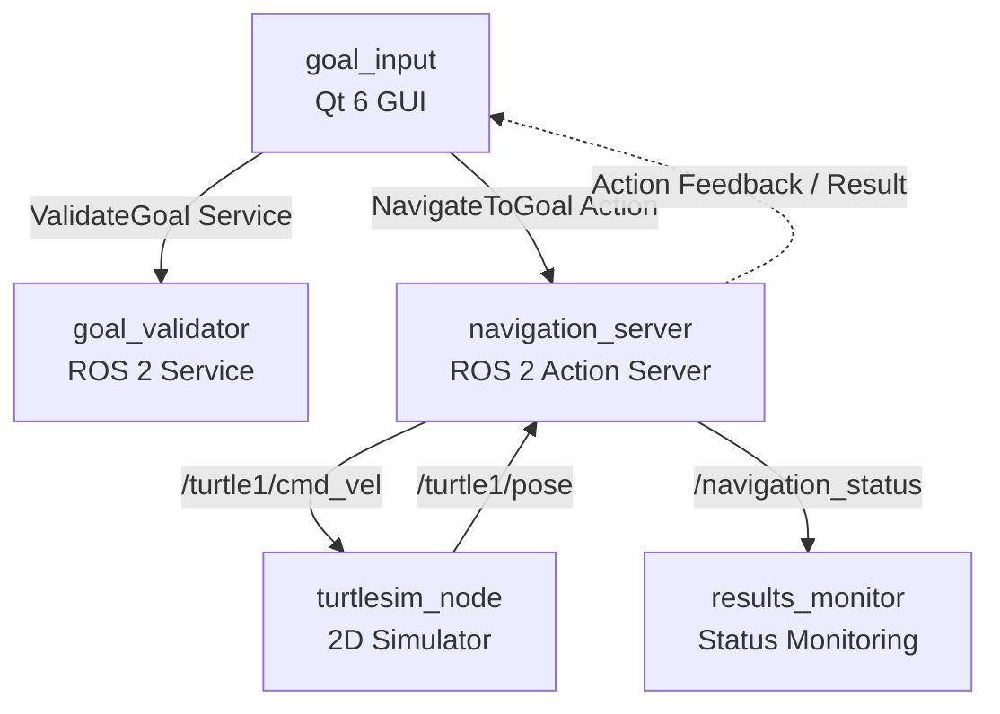

# System Architecture

## 1. Introduction

Turtle Navigator is a ROS 2-based autonomous navigation application designed to demonstrate the integration of multiple ROS 2 communication mechanisms within a modular software architecture.

The system combines a Qt 6 graphical user interface, a goal validation service, an action-based navigation controller, and a monitoring component.

The application operates in a 2D simulated environment provided by Turtlesim.

Its architecture separates user interaction, goal validation, motion control, and system monitoring into independent ROS 2 nodes.

## 2. High-Level Architecture

The system consists of five runtime nodes:

1. `goal_input`
2. `goal_validator`
3. `navigation_server`
4. `results_monitor`
5. `turtlesim_node`

The first four nodes are developed as part of this project. The Turtlesim node provides the simulation environment.

### Architecture Overview

## 3. ROS 2 Packages

The project is organized into two packages.

### 3.1 turtle_navigator

This is the main application package. It contains the implementation of the four application nodes and the launch file.

Main components:

- `goal_input.cpp`
- `goal_validator.cpp`
- `navigation_server.cpp`
- `results_monitor.cpp`
- `turtle_navigator.launch.py`

### 3.2 turtle_navigator_interfaces

This package defines the custom interfaces used for communication between application components.

It contains:

- `Goal.msg`
- `NavigationStatus.msg`
- `ValidateGoal.srv`
- `NavigateToGoal.action`

Separating interfaces from application logic improves modularity and allows multiple nodes to share consistent message definitions.

## 4. Node Responsibilities

### 4.1 Goal Input Node

**Executable:** `goal_input`

**Technology:** C++ and Qt 6 Widgets

The goal input node provides the graphical interface through which users interact with the navigation system.

Responsibilities:

- Accept target X and Y coordinates.
- Allow optional final orientation input.
- Send goal validation requests.
- Submit accepted goals to the navigation action server.
- Display navigation feedback and final results.
- Request cancellation of active navigation.

The Qt event loop and ROS 2 executor run in separate threads. ROS callbacks communicate with the graphical interface through queued Qt invocations to avoid directly updating GUI elements from the ROS thread.

### 4.2 Goal Validator Node

**Executable:** `goal_validator`

The goal validator provides a ROS 2 service named `/validate_goal`.

Responsibilities:

- Receive a requested target position.
- Check whether the coordinates satisfy the configured safety margin.
- Return an acceptance result and an explanatory message.
- Support runtime adjustment of the `safety_margin` parameter.

The default safety margin is `1.0`.

### 4.3 Navigation Server Node

**Executable:** `navigation_server`

The navigation server implements the `/navigate_to_goal` ROS 2 Action Server.

Responsibilities:

- Accept navigation goals.
- Read the turtle's current pose.
- Calculate distance and angular errors.
- Generate velocity commands.
- Publish navigation feedback.
- Handle goal cancellation and replacement.
- Report the final navigation result.
- Publish navigation status and measurements.

The controller uses the turtle's current pose to calculate the required linear and angular velocity commands.

### 4.4 Results Monitor Node

**Executable:** `results_monitor`

The results monitor subscribes to `/navigation_status`.

It reports:

- Current navigation state.
- Current turtle position.
- Target position.
- Remaining distance.
- Total traveled distance.
- Elapsed navigation time.

To avoid excessive console output, periodic measurements are reported approximately once per second while navigation is active, in addition to state changes.

### 4.5 Turtlesim Node

**Executable:** `turtlesim_node`

Turtlesim provides the simulated robot and 2D environment.

It receives velocity commands and publishes the turtle's current pose.

It is an external ROS 2 package, not an implementation component developed by this project.

## 5. Communication Architecture

The system uses ROS 2 Topics, Services, Actions, and Parameters.

### 5.1 Topics

| Topic | Message Type | Publisher | Subscriber |
|---|---|---|---|
| `/turtle1/cmd_vel` | `geometry_msgs/msg/Twist` | `navigation_server` | `turtlesim_node` |
| `/turtle1/pose` | `turtlesim_msgs/msg/Pose` | `turtlesim_node` | `navigation_server` |
| `/navigation_status` | `turtle_navigator_interfaces/msg/NavigationStatus` | `navigation_server` | `results_monitor` |

### 5.2 Services

| Service | Service Type | Client | Server |
|---|---|---|---|
| `/validate_goal` | `turtle_navigator_interfaces/srv/ValidateGoal` | `goal_input` | `goal_validator` |

The service provides a request-response mechanism for checking whether a requested goal is acceptable before navigation starts through the GUI workflow.

### 5.3 Actions

| Action | Action Type | Client | Server |
|---|---|---|---|
| `/navigate_to_goal` | `turtle_navigator_interfaces/action/NavigateToGoal` | `goal_input` | `navigation_server` |

Actions are used because navigation is a long-running operation that requires feedback, a final result, and cancellation support.

### 5.4 Parameters

| Parameter | Node | Default Value | Purpose |
|---|---|---|---|
| `safety_margin` | `goal_validator` | `1.0` | Defines the permitted boundary margin for target coordinates. |

## 6. Navigation Data Flow

The normal navigation process follows these steps:

1. The user enters a target through the Qt interface.
2. The GUI sends a validation request to `/validate_goal`.
3. The goal validator checks the requested coordinates.
4. If the goal is accepted, the GUI can submit it to `/navigate_to_goal`.
5. The navigation server receives the goal and reads the current turtle pose.
6. The controller calculates the required motion commands.
7. Velocity commands are published to `/turtle1/cmd_vel`.
8. Turtlesim updates the turtle's position and publishes `/turtle1/pose`.
9. The navigation server uses the updated pose to calculate progress.
10. Feedback is sent to the GUI, while navigation status is published for monitoring.
11. The action server reports the final result when navigation finishes or is canceled.

## 7. Launch Architecture

The launch file:

`launch/turtle_navigator.launch.py`

starts all five runtime nodes:

- Turtlesim simulator.
- Goal validator.
- Navigation server.
- Results monitor.
- Qt goal input interface.

Starting the system through one launch command simplifies execution and ensures that the required components are brought up together.

## 8. Design Principles

The architecture follows several software design principles:

- **Modularity:** Each ROS 2 node has a specific responsibility.
- **Separation of Concerns:** User interaction, validation, motion control, and monitoring are implemented separately.
- **ROS 2 Communication:** Standard ROS 2 communication mechanisms connect independent components.
- **Custom Interfaces:** Application-specific messages, services, and actions define communication contracts.
- **Thread Separation:** The Qt event loop is separated from ROS 2 callback execution.
- **Maintainability:** Components can be extended or improved independently.

## 9. Architecture Limitations

The current architecture is designed for a controlled Turtlesim environment.

It does not include:

- SLAM or localization systems.
- Map-based path planning.
- Obstacle detection or avoidance.
- Nav2 integration.
- Hardware robot drivers.

These capabilities are potential future extensions rather than implemented features.

---

