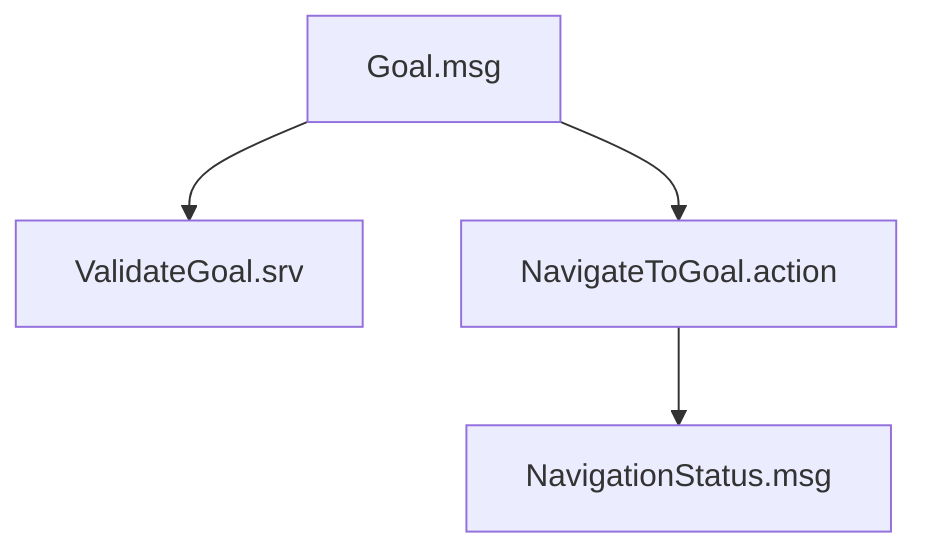

# Custom ROS 2 Interfaces

## 1. Introduction

Turtle Navigator uses custom ROS 2 interfaces to define the data exchanged between its application components.

These interfaces are implemented in a separate package:

`turtle_navigator_interfaces`

Separating interface definitions from application logic improves modularity and allows other ROS 2 packages to reuse the same communication structures.

The package currently defines:

- Two custom messages.
- One custom service.
- One custom action.

## 2. Package Structure

```text
turtle_navigator_interfaces/
├── action/
│   └── NavigateToGoal.action
├── msg/
│   ├── Goal.msg
│   └── NavigationStatus.msg
├── srv/
│   └── ValidateGoal.srv
├── CMakeLists.txt
└── package.xml
```

## 3. Goal Message

**Interface:** `Goal.msg`

**ROS 2 Type:** `turtle_navigator_interfaces/msg/Goal`

### Definition

```text
# Target X coordinate
float64 x

# Target Y coordinate
float64 y

# Target orientation in radians
float64 theta

# Whether the user specified an orientation
bool use_theta
```

### Field Description

| Field | Type | Description |
|---|---|---|
| `x` | `float64` | Target X coordinate. |
| `y` | `float64` | Target Y coordinate. |
| `theta` | `float64` | Target orientation in radians. |
| `use_theta` | `bool` | Indicates whether final orientation should be considered. |

### Purpose

The `Goal` message represents a navigation target.

It provides a common data structure that can be reused by both the validation service and navigation action.

When `use_theta` is true, the navigation server also considers the requested final orientation.

## 4. Navigation Status Message

**Interface:** `NavigationStatus.msg`

**ROS 2 Type:** `turtle_navigator_interfaces/msg/NavigationStatus`

### Definition

```text
# Navigation states
uint8 IDLE=0
uint8 ACTIVE=1
uint8 SUCCEEDED=2
uint8 CANCELED=3
uint8 ABORTED=4

# Current navigation state
uint8 state

# Current turtle position
float64 current_x
float64 current_y
float64 current_theta

# Target position
float64 target_x
float64 target_y

# Navigation measurements
float64 remaining_distance
float64 total_distance
float64 elapsed_time
```

### Field Description

| Field | Type | Description |
|---|---|---|
| `IDLE` | `uint8` constant | No active navigation goal. |
| `ACTIVE` | `uint8` constant | Navigation is in progress. |
| `SUCCEEDED` | `uint8` constant | Navigation completed successfully. |
| `CANCELED` | `uint8` constant | Navigation was canceled. |
| `ABORTED` | `uint8` constant | Navigation was terminated unsuccessfully. |
| `state` | `uint8` | Current navigation state. |
| `current_x` | `float64` | Current turtle X coordinate. |
| `current_y` | `float64` | Current turtle Y coordinate. |
| `current_theta` | `float64` | Current turtle orientation in radians. |
| `target_x` | `float64` | Target X coordinate. |
| `target_y` | `float64` | Target Y coordinate. |
| `remaining_distance` | `float64` | Estimated distance remaining to the target. |
| `total_distance` | `float64` | Accumulated distance traveled during navigation. |
| `elapsed_time` | `float64` | Elapsed navigation time in seconds. |

### Purpose

The navigation server publishes this message through:

`/navigation_status`

The results monitor subscribes to this topic to display navigation measurements and state transitions.

The message provides a shared representation of the navigation process for monitoring components.

## 5. Goal Validation Service

**Interface:** `ValidateGoal.srv`

**ROS 2 Type:** `turtle_navigator_interfaces/srv/ValidateGoal`

### Definition

```text
# Request: target goal
turtle_navigator_interfaces/Goal goal
---
# Response: validation result
bool accepted

# Explanation if the goal is rejected
string reason
```

### Request

| Field | Type | Description |
|---|---|---|
| `goal` | `turtle_navigator_interfaces/Goal` | Requested navigation target. |

### Response

| Field | Type | Description |
|---|---|---|
| `accepted` | `bool` | Indicates whether the target passed validation. |
| `reason` | `string` | Provides an explanation of the validation result. |

### Communication

| Role | Node |
|---|---|
| Service Client | `goal_input` |
| Service Server | `goal_validator` |
| Service Name | `/validate_goal` |

### Purpose

The validation service checks whether the requested target satisfies the configured coordinate boundaries and safety margin.

The GUI uses the response to determine whether the requested goal can proceed through the normal navigation workflow.

## 6. Navigation Action

**Interface:** `NavigateToGoal.action`

**ROS 2 Type:** `turtle_navigator_interfaces/action/NavigateToGoal`

### Definition

```text
# Goal: target position and orientation
turtle_navigator_interfaces/Goal target
---
# Result: final navigation outcome
bool success

# Total distance traveled
float64 total_distance

# Total time taken
builtin_interfaces/Duration total_time
---
# Feedback: remaining distance to target
float64 remaining_distance
```

An action definition is divided into three sections using separator lines:

1. Goal.
2. Result.
3. Feedback.

### Goal Fields

| Field | Type | Description |
|---|---|---|
| `target` | `turtle_navigator_interfaces/Goal` | Requested navigation target. |

### Result Fields

| Field | Type | Description |
|---|---|---|
| `success` | `bool` | Indicates whether navigation succeeded. |
| `total_distance` | `float64` | Total estimated distance traveled. |
| `total_time` | `builtin_interfaces/Duration` | Time taken to complete or terminate the goal. |

### Feedback Fields

| Field | Type | Description |
|---|---|---|
| `remaining_distance` | `float64` | Estimated remaining distance to the target. |

### Communication

| Role | Node |
|---|---|
| Action Client | `goal_input` |
| Action Server | `navigation_server` |
| Action Name | `/navigate_to_goal` |

### Purpose

Navigation is a long-running operation, so an Action interface is more suitable than a simple service.

It allows the client to:

- Submit a navigation goal.
- Receive progress feedback.
- Receive the final result.
- Request cancellation.

## 7. Interface Relationships

The custom interfaces work together throughout the navigation workflow.



The `Goal` message is reused by the validation service and navigation action.

The action manages the navigation operation, while the status message provides additional information for monitoring.

## 8. Building and Inspecting Interfaces

Build the interface package and its dependent application package:

```bash
cd ~/ros2_ws
source /opt/ros/lyrical/setup.bash

colcon build --packages-up-to turtle_navigator_interfaces
```

Source the workspace:

```bash
source install/setup.bash
```

Inspect the custom message:

```bash
ros2 interface show turtle_navigator_interfaces/msg/Goal
```

Inspect the navigation status message:

```bash
ros2 interface show turtle_navigator_interfaces/msg/NavigationStatus
```

Inspect the validation service:

```bash
ros2 interface show turtle_navigator_interfaces/srv/ValidateGoal
```

Inspect the navigation action:

```bash
ros2 interface show turtle_navigator_interfaces/action/NavigateToGoal
```

## 9. Design Considerations

The custom interfaces follow these design principles:

- **Reusability:** The `Goal` message is shared between different communication interfaces.
- **Consistency:** Navigation data uses common definitions across application nodes.
- **Separation:** Interface definitions are maintained independently from application implementation.
- **Clarity:** Each field has a specific purpose and an appropriate data type.
- **Extensibility:** Additional fields and interfaces can be introduced as the application evolves.

---

