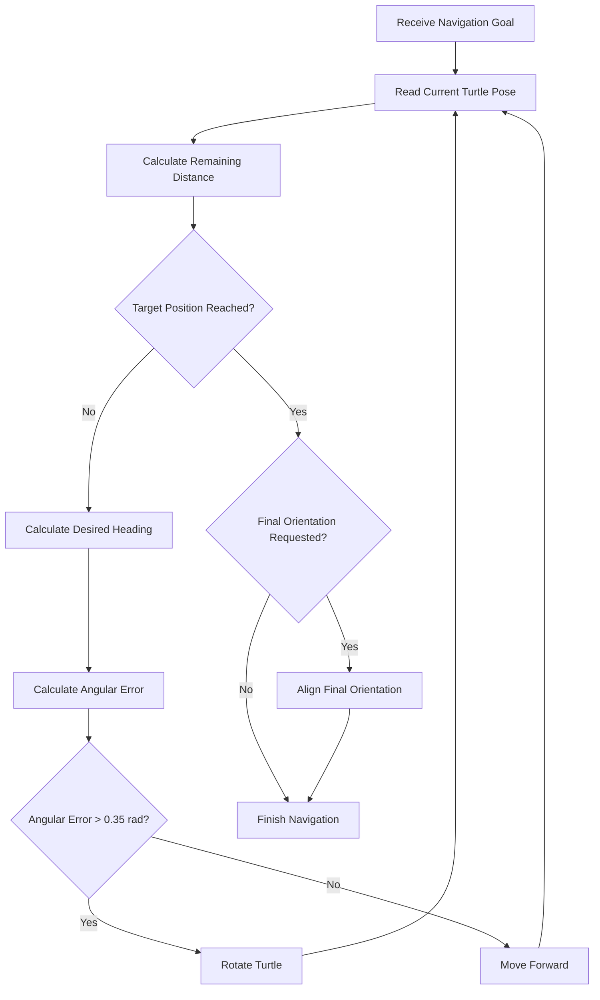

# Navigation Algorithm and Motion Control

## 1. Introduction

This document describes the navigation algorithm implemented in the `navigation_server` node.

The algorithm controls a simulated turtle in a two-dimensional environment using pose feedback from Turtlesim.

It calculates the required heading and distance to a target, generates linear and angular velocity commands, and continuously updates the navigation process.

The implementation uses a basic feedback-based motion controller rather than a global path planner.

## 2. Navigation Inputs

The navigation controller uses two main inputs:

### Current Turtle Pose

Received from:

`/turtle1/pose`

The pose contains:

- Current X coordinate.
- Current Y coordinate.
- Current orientation in radians.

### Target Goal

Received through:

`/navigate_to_goal`

The goal contains:

- Target X coordinate.
- Target Y coordinate.
- Optional target orientation.
- A flag indicating whether final orientation is required.

## 3. Distance Calculation

The Euclidean distance measures the remaining distance between the turtle's current position and the target position.

Let:

- Current position: `(x, y)`
- Target position: `(x_g, y_g)`

The distance is calculated as:

```text
distance = sqrt((x_g - x)^2 + (y_g - y)^2)
```

The navigation controller continuously recalculates this value using the latest pose measurements.

## 4. Desired Heading Calculation

The desired heading represents the direction from the turtle's current position toward the target.

It is calculated using the `atan2` function:

```text
desired_heading = atan2(y_g - y, x_g - x)
```

The function considers both coordinate differences to determine the correct direction.

The resulting angle is expressed in radians.

## 5. Angular Error Calculation

The angular error is the difference between the desired heading and the turtle's current orientation.

```text
angular_error = desired_heading - current_heading
```

The calculated error is normalized to the range:

```text
-pi <= angular_error <= pi
```

This ensures that the turtle rotates through the shortest angular direction toward the target.


## 6. Motion Control Strategy

The controller follows two main motion phases.

### Phase 1: Angular Alignment

Before moving toward the target, the turtle aligns its heading with the desired direction.

The controller checks the absolute angular error.

If:

```text
abs(angular_error) > 0.35 rad
```

The turtle rotates without commanding forward movement.

The angular velocity is calculated using proportional control:

```text
angular_velocity = Kp * angular_error
```

Where:

```text
Kp = 4.0
```

The angular velocity is limited to:

```text
-2.0 <= angular_velocity <= 2.0 rad/s
```

### Phase 2: Linear Movement

When the angular error is sufficiently small, the controller commands forward movement.

The linear velocity is calculated as:

```text
linear_velocity = min(1.5, 1.5 * distance)
```

This provides distance-dependent speed control.

- Far from the target, the velocity can reach 1.5 units/s.
- Near the target, the velocity decreases proportionally to the remaining distance.

The controller continuously receives pose updates and recalculates its commands.

## 7. Navigation Control Flow



## 8. Position Tolerance

The navigation server considers the target position reached when:

```text
distance <= 0.10
```

This avoids requiring an exact floating-point coordinate match.

The tolerance provides a practical stopping condition for simulated motion.

## 9. Final Orientation Control

The user can optionally request a final orientation.

After reaching the target position, the controller compares the current turtle orientation with the requested final orientation.

The angular error is calculated and normalized to the range:

```text
-pi <= final_angular_error <= pi
```

The controller considers the final orientation reached when:

```text
abs(final_angular_error) <= 0.05 rad
```

If the orientation error exceeds this tolerance, the turtle continues rotating until the requested orientation is reached.

If final orientation is not requested, navigation finishes after the position tolerance is satisfied.

## 10. Control Loop Frequency

The navigation server uses a timer interval of:

```text
timer_period = 50 ms
```

The corresponding update frequency is:

```text
frequency = 1 / 0.05 = 20 Hz
```

At each control update, the server:

1. Checks the active navigation goal.
2. Checks whether cancellation was requested.
3. Reads the latest pose.
4. Calculates navigation errors.
5. Generates velocity commands.
6. Publishes navigation feedback.
7. Updates navigation status.

## 11. Distance Measurement

The total traveled distance is estimated from consecutive pose measurements.

For two consecutive positions:

```text
Previous position = (x_previous, y_previous)
Current position  = (x_current, y_current)
```

The distance between them is:

```text
step_distance = sqrt(
    (x_current - x_previous)^2 +
    (y_current - y_previous)^2
)
```

The accumulated distance is:

```text
total_distance = sum(step_distance)
```

This provides an estimate of the turtle's traveled path based on the received pose samples.

## 12. Elapsed Time Measurement

The navigation server records the navigation start time and calculates elapsed time during execution.

```text
elapsed_time = current_time - start_time
```

The final elapsed time is included in the navigation action result as a ROS 2 Duration value.


## 13. Cancellation and Goal Replacement

The navigation server supports two important runtime behaviors.

### Cancellation

When a cancellation request is accepted:

1. The active navigation goal is marked for cancellation.
2. The control loop stops the turtle.
3. The final measurements are recorded.
4. The action result is completed.
5. The navigation state becomes `CANCELED`.

### Goal Replacement

When a new goal is accepted while another goal is active:

1. The previous goal is terminated.
2. The turtle is stopped.
3. The previous goal receives an unsuccessful result.
4. The new goal becomes active.
5. Navigation measurements are initialized for the new goal.

The previous goal is reported as `ABORTED` unless it was already in the cancellation process.

## 14. Controller Characteristics

The implemented controller is a simple feedback-based controller with the following characteristics:

- Uses current pose measurements.
- Calculates target distance and heading.
- Separates angular alignment from forward movement.
- Uses proportional angular control.
- Limits linear and angular velocity.
- Uses a position tolerance for stopping.
- Supports optional final orientation control.

It is suitable for demonstrating basic autonomous point-to-point motion in Turtlesim.

## 15. Current Limitations

The current navigation algorithm has several limitations:

- It does not generate a global path.
- It does not perform obstacle detection or avoidance.
- It does not use a map or localization system.
- It uses a simple alignment-then-movement strategy.
- It has not been evaluated on a physical robot.
- Its performance depends on the simulated pose update behavior.

Future improvements could include more advanced controllers, path planning, obstacle avoidance, and integration with Nav2.

---

