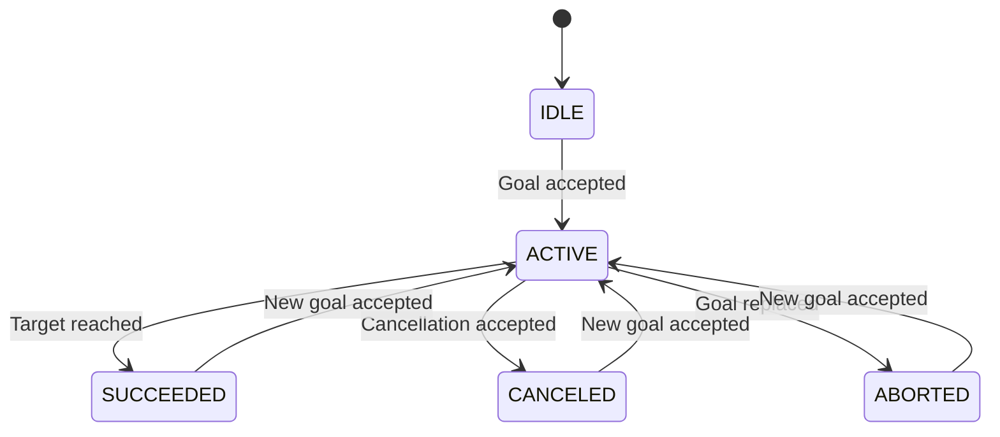

# System Design

## 1. Introduction

This document describes the internal software design of Turtle Navigator, including its component responsibilities, execution flow, navigation control logic, and runtime behavior.

The system is implemented using ROS 2 and C++, with Qt 6 providing the graphical user interface.

The design separates the application into independent components to simplify communication, testing, and future development.

## 2. Software Design Overview

The application follows a modular, node-based design.

Each node is responsible for a specific part of the system:

| Component | Main Responsibility |
|---|---|
| Goal Input | User interaction and goal submission |
| Goal Validator | Goal boundary validation |
| Navigation Server | Navigation execution and motion control |
| Results Monitor | Navigation status monitoring |
| Turtlesim | Robot simulation |

The custom interface package provides the communication definitions shared by the application nodes.

## 3. Goal Input and Validation Design

### 3.1 User Input

The Qt interface allows the user to specify:

- Target X coordinate.
- Target Y coordinate.
- Optional target orientation.
- Whether final orientation should be considered.

The interface provides controls for validating, starting, and canceling navigation.

### 3.2 Goal Validation

Before starting navigation through the GUI workflow, the application sends a request to the `/validate_goal` service.

The validator checks whether the target coordinates satisfy the configured safety margin.

For a Turtlesim environment with coordinate boundaries from 0 to 11, the accepted coordinate range is:

\[
m \leq x \leq 11-m
\]

\[
m \leq y \leq 11-m
\]

Where \(m\) is the `safety_margin` parameter.

The default value is:

\[
m = 1.0
\]

The service returns:

- `accepted`: Whether the requested goal passes validation.
- `reason`: An explanation of the validation result.

The safety margin can be changed at runtime using ROS 2 parameters.

**Important implementation detail:** The validation service is part of the GUI submission workflow. The navigation action server also checks that target coordinates are finite and within the basic Turtlesim boundaries, but it does not independently apply the validator's configurable safety margin.

## 4. Navigation Server Design

### 4.1 Action Server

The navigation server exposes the following action:

`/navigate_to_goal`

It uses the custom `NavigateToGoal` action interface.

The action mechanism provides three main communication stages:

- **Goal:** Receives the requested target.
- **Feedback:** Reports the remaining distance.
- **Result:** Reports whether navigation succeeded and provides the total distance and elapsed time.

The server also supports cancellation and replacement of an active goal.

### 4.2 Pose Feedback

The navigation server subscribes to:

`/turtle1/pose`

This topic provides the turtle's current position and orientation.

The controller uses the received pose to calculate the distance and angular error relative to the target.

### 4.3 Motion Control

The navigation controller uses a basic feedback-based motion control approach.

The target position is represented by:

\[
(x_g, y_g)
\]

The current turtle position is:

\[
(x, y)
\]

The position error is calculated using Euclidean distance:

\[
d = \sqrt{(x_g-x)^2+(y_g-y)^2}
\]

The desired heading is calculated from the target direction:

\[
\theta_d = \operatorname{atan2}(y_g-y,\ x_g-x)
\]

The angular error is the normalized difference between the desired heading and the current orientation:

\[
e_\theta = \operatorname{normalize}(\theta_d-\theta)
\]

The controller first aligns the turtle toward the target. When the angular error is sufficiently small, it commands forward motion.

The current implementation uses:

- An angular alignment threshold of approximately 0.35 radians.
- A proportional angular control gain of 4.0.
- A maximum angular velocity magnitude of 2.0 rad/s.
- A distance-based linear velocity command capped at 1.5 units/s.
- A position tolerance of 0.10 units.

The linear velocity command is:

\[
v = \min(1.5,\ 1.5d)
\]

The angular velocity is calculated using proportional control and limited to the configured maximum magnitude.

Velocity commands are published to:

`/turtle1/cmd_vel`

The controller updates at approximately 20 Hz using a 50 ms timer interval.

### 4.4 Final Orientation

The user can optionally request a final orientation.

When this option is enabled, the navigation server also aligns the turtle with the requested final angle after reaching the target position.

The final orientation tolerance is approximately:

\[
0.05 \text{ radians}
\]

### 4.5 Navigation Measurements

The navigation server maintains measurements during execution:

- Remaining distance to the target.
- Accumulated traveled distance.
- Elapsed navigation time.
- Number of received pose samples.
- Maximum distance between consecutive pose samples.

The accumulated traveled distance is estimated from consecutive turtle pose measurements.

## 5. Navigation State Management

The navigation status uses the following states:

| State | Value | Description |
|---|---:|---|
| IDLE | 0 | No active navigation |
| ACTIVE | 1 | Navigation is in progress |
| SUCCEEDED | 2 | Navigation completed successfully |
| CANCELED | 3 | Navigation was canceled |
| ABORTED | 4 | Navigation was interrupted or terminated unsuccessfully |

### Navigation State Flow

When a new goal replaces an existing active goal, the previous goal is terminated and the new goal becomes active.

The previous goal is reported as canceled if it was already in the cancellation process; otherwise, it is reported as aborted.

## 6. Results Monitoring Design

The results monitor subscribes to:

`/navigation_status`

The navigation server publishes a custom `NavigationStatus` message containing:

- Navigation state.
- Current position and orientation.
- Target position.
- Remaining distance.
- Total traveled distance.
- Elapsed time.

The publisher uses transient-local QoS so that a newly connected subscriber can receive the most recently published status.

The monitoring node reports status changes immediately and limits periodic active-navigation output to approximately one update per second.

## 7. Threading Model

The graphical interface and ROS 2 communication operate using separate execution mechanisms.

### Qt Thread

The Qt main thread handles:

- Window creation and display.
- User input.
- Button interactions.
- GUI updates.

### ROS 2 Thread

A dedicated thread runs the ROS 2 executor and handles:

- Service responses.
- Action responses.
- Action feedback.
- Action results.
- ROS communication callbacks.

### Thread-Safe GUI Updates

ROS callbacks must not directly modify Qt widgets from the ROS execution thread.

The implementation uses:

`QMetaObject::invokeMethod(..., Qt::QueuedConnection)`

This schedules GUI updates through the Qt event loop, helping keep GUI operations in the correct thread.

## 8. Runtime Execution Sequence

The complete system starts through the ROS 2 launch file.

The runtime sequence is:

1. The Turtlesim simulator starts.
2. The goal validator starts and creates its validation service.
3. The navigation server starts and creates its action server and communication interfaces.
4. The results monitor starts and subscribes to navigation status.
5. The Qt goal input application starts.
6. The user enters a navigation target.
7. The GUI requests goal validation.
8. The GUI submits an accepted goal to the action server.
9. The navigation server executes the control loop.
10. The simulator receives velocity commands and publishes updated pose measurements.
11. The GUI and monitoring node receive navigation progress.
12. The action server reports the final navigation result.

## 9. Design Considerations

The implementation follows these design considerations:

### Modularity

Each node performs a clearly defined task, reducing dependencies between application components.

### Asynchronous Communication

ROS 2 services and actions allow communication without requiring the GUI to perform navigation calculations itself.

### Feedback-Based Control

The navigation server continuously uses updated pose measurements to adjust its velocity commands.

### Runtime Configurability

The goal validator's safety margin can be adjusted without rebuilding the application.

### GUI Responsiveness

Separating the ROS 2 executor from the Qt event loop prevents ROS communication from blocking normal GUI interaction.

## 10. Current Design Limitations

The current design is intended for a simulated environment and uses a relatively simple navigation controller.

Known limitations include:

- No obstacle detection or avoidance.
- No map generation or localization.
- No global or local path planner.
- No Nav2 integration.
- The configurable safety margin is enforced by the validation service, not independently by the action server.
- Navigation performance has only been evaluated in the Turtlesim environment.

These limitations define the current project scope and provide opportunities for future improvements.

---
